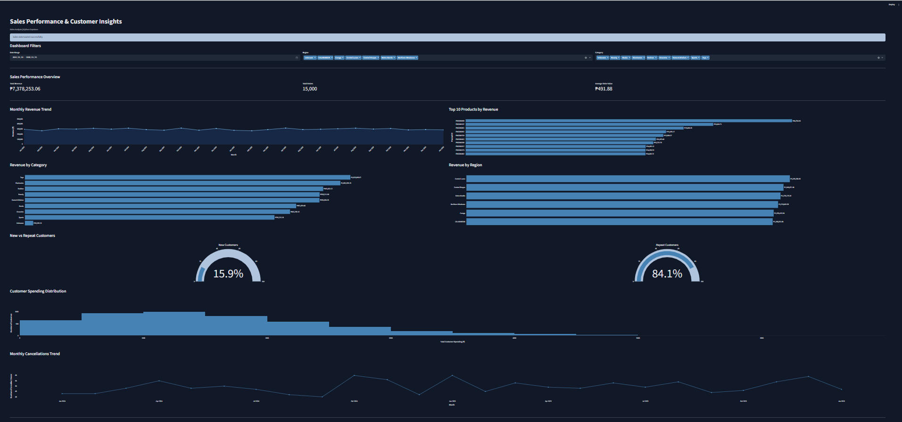

# Sales Performance & Customer Insights

**Python Analytics Capstone | Sales Performance Analysis**

## I. Project Overview

This project analyzes store sales performance and customer purchasing behavior using Python. It integrates multiple datasets covering customers, products, orders, order items, payments, shipments, and returns.

The objective is to evaluate revenue performance, identify leading products and categories, understand regional sales distribution, and examine customer purchasing behavior.

The project includes data cleaning, exploratory data analysis, fact-table creation, KPI calculations, and an interactive Streamlit dashboard.

## II. Business Questions

1. **Overall Sales Performance:** How is the store performing in terms of total revenue, total orders, and average order value (AOV)?
2. **Revenue Trends:** How does revenue change over time based on the monthly revenue trend?
3. **Product and Category Performance:** Which are the top 10 products by revenue, and which categories contribute the most revenue?
4. **Regional Performance:** How does revenue vary across regions?
5. **Customer Purchasing Behavior:** What is the distribution of new versus repeat customers based on a defined number of orders?

## III. Key Insights

- Gross line revenue reached **₱7,378,253.06** across **15,000 distinct orders**.
- Average order value (AOV) was **₱491.88**.
- April 2025 recorded the highest monthly revenue, while February 2025 recorded the lowest.
- Toys generated the highest recognized category revenue, followed by Electronics.
- Product PROD00608 generated ₱44,754.54, approximately 32% more than the second-highest product.
- Central Luzon recorded the highest revenue among the six regions analyzed.
- Repeat customers represented 84.1% of identified customers under the selected-period definition.
- Monthly cancellations fluctuated between 40 and 60 orders, with no consistent upward or downward trend.

## IV. Business Recommendations

1. **Improve Product and Category Decisions:** Review leading products and high-revenue categories alongside inventory, pricing, and promotional data to identify opportunities for better product availability and merchandising.

2. **Strengthen Customer and Operational Performance:** Examine repeat purchasing patterns, cancellation activity, and regional order volume, customer counts, and AOV before deciding on customer retention or regional resource-allocation strategies.

## V. Impact / Value

The project provides a consolidated view of sales performance through an interactive dashboard with date, region, and category filters.

It enables users to explore revenue trends, compare product and regional performance, examine customer spending patterns, and monitor cancellations.

The analysis also identifies data-quality limitations, including unmatched product and customer identifiers and unavailable revenue values, which should be considered when interpreting results.

## VI. Tech Stack and Python Technical Implementation

**Technologies**
- Python
- Pandas
- NumPy
- Plotly
- Streamlit
- Jupyter Notebook

**Technical Implementation**
- Loaded and inspected multiple CSV datasets.
- Cleaned and standardized customer, product, order, and supporting datasets.
- Validated duplicate records and join keys.
- Handled missing and unmatched records.
- Created a consolidated order-item fact table.
- Calculated sales KPIs and performed business analysis.
- Developed interactive visualizations and dashboard filters using Streamlit and Plotly.

## Dashboard



Individual chart exports are available in [`screenshots/charts/`](screenshots/charts/).

## Project Structure

```text
sales-performance-customer-insights/
├── app.py
├── analysis.ipynb
├── requirements.txt
├── executive_summary.txt
├── README.md
├── data/
│   └── cleaned_datasets/
└── screenshots/
    ├── dashboard.png
    └── charts/
```

## How to Run

Install the required dependencies:

```bash
pip install -r requirements.txt
```

Run the Streamlit dashboard:

```bash
python -m streamlit run app.py
```

## Data Interpretation Note

Gross line revenue includes all order statuses and should not be interpreted as net revenue or completed-order revenue. Some records have unmatched product or customer identifiers, and some revenue values are unavailable. These limitations should be considered when interpreting totals and category/customer attribution.

## Related Assignment

The following repository contains the Python Bootcamp assignments and practical exercises associated with my data analytics training.

**[View Python Bootcamp Assignment and Deliverables — Days 2–6](https://github.com/FlyingRaijin47/python-bootcamp-capstone)**
